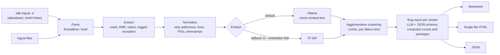

# logcat-ai-triage

Turns a raw Android logcat dump into deduplicated, Jira-ready bug reports: one per distinct failure, with occurrence counts, affected packages and a root-cause hypothesis, using local models only.

[](https://github.com/Gabnagawo/logcat-ai-triage/actions/workflows/ci.yml)
[](https://www.python.org/downloads/release/python-3120/)
[](LICENSE)

## Why

A long manual or automated test session on Android leaves thousands of logcat lines behind. The same crash shows up dozens of times with different PIDs, timestamps, line numbers and message parameters, next to ANRs, native crashes and exceptions that the app caught and logged. Someone then has to read all of it, decide which failures are the same bug, and write tickets.

`logcat-triage` automates that loop:

- **Extracts** Java crashes (`FATAL EXCEPTION`), ANRs (`ANR in`), native crashes (`Fatal signal` + tombstone backtrace) and logged exceptions (including `Caused by` chains), even when other processes interleave lines into the middle of a stack trace.
- **Normalizes** each trace so that two occurrences of one bug look identical: addresses, line numbers, PIDs/TIDs, timestamps, install-path hashes, build ids and numeric parameters are removed.
- **Clusters** similar failures with scikit-learn on Ollama `nomic-embed-text` embeddings, or TF-IDF when Ollama is unavailable.
- **Writes one report per cluster** with a local LLM (`qwen3:8b` by default). The LLM only writes the judgment fields; counts, packages and timestamps come from the data and cannot be hallucinated.

Everything runs offline against a local Ollama. Anthropic and OpenAI are optional extras.

## How it works



1. **Parse.** `threadtime` (the `adb logcat` default, with or without `-v year`) and `brief` lines become typed records; unknown lines are kept so line numbers match the file.
2. **Extract.** A single-pass state machine tracks open blocks per `(pid, tag)`, so interleaved output does not cut a trace. Tombstone backtraces from `crash_dump` are attached to the matching `Fatal signal` line by PID. Exception headers without stack frames are ignored.
3. **Normalize.** Each event becomes a signature: kind, exception type, package, normalized message, `Caused by` headers and up to 12 normalized frames.
4. **Cluster.** Signatures are embedded and grouped with `AgglomerativeClustering(metric="cosine", linkage="average", distance_threshold=...)`, so the number of clusters is not fixed in advance. Crashes, ANRs, native crashes and logged exceptions are clustered separately and never merged.
5. **Report.** For the largest clusters (default 10), the representative event (the medoid) goes to the LLM with its normalized stack, the log lines that preceded it and severity rules. The answer must match a JSON schema; invalid output is retried once and then replaced by a rule-based report marked `heuristic`. Steps to reproduce are always labeled as inferred from log context.

LLM and embedding calls run one at a time, with a per-request timeout (`LLM_TIMEOUT`, default 120 s) and bounded retries with backoff (`LLM_MAX_RETRIES`, default 2), because the Ollama server may be shared with other workloads.

## Quick start

Requires Python 3.12, [uv](https://docs.astral.sh/uv/) and, for the full pipeline, [Ollama](https://ollama.com) with `qwen3:8b` and `nomic-embed-text` pulled.

```bash
git clone https://github.com/Gabnagawo/logcat-ai-triage && cd logcat-ai-triage
uv sync
uv run logcat-triage triage samples -o out/demo     # same as: make demo
```

Open `out/demo/triage.html`, or read `out/demo/triage.md`. Without Ollama, add `--embedder tfidf --no-llm` (or run `make demo-offline`) to get TF-IDF clusters and rule-based reports.

### Other commands

```bash
# Collect from a connected device (read-only: only `adb devices` and `adb logcat -d` are allowed)
uv run logcat-triage collect -o out/device.logcat --serial emulator-5554
uv run logcat-triage triage --adb --serial emulator-5554 -o out/device

# Replay a file through the fake ADB transport (no device needed)
uv run logcat-triage triage --adb --fake-device samples/device-001.logcat -o out/fake

# Generate synthetic logs with ground truth, then score clustering against it
uv run logcat-triage synth --out-dir data/eval --seed 100 --seed 101
uv run logcat-triage evaluate data/eval -e tfidf -e ollama
```

### Configuration

| Variable | Default | Purpose |
|---|---|---|
| `LLM_PROVIDER` | `ollama` | `ollama`, `anthropic` or `openai` |
| `LLM_MODEL` | `qwen3:8b` (Ollama), `claude-sonnet-5-5` (Anthropic) | OpenAI has no default; set it |
| `OLLAMA_HOST` | `http://localhost:11434` | Ollama server |
| `EMBED_MODEL` | `nomic-embed-text` | Ollama embedding model |
| `LLM_TIMEOUT` / `LLM_MAX_RETRIES` | `120` / `2` | Bounds for every LLM and embedding call |
| `ANTHROPIC_API_KEY` / `OPENAI_API_KEY` | unset | Only for the hosted providers |

Hosted providers are optional extras: `uv sync --extra anthropic` or `uv sync --extra openai`. Copy `.env.example` to `.env` to set these locally; `.env` is gitignored. Without `make` (for example on Windows), every Makefile target is a single `uv run` command that can be copied from the `Makefile`.

## Example output

Real run of `uv run logcat-triage triage samples -o docs/results/demo` against a local Ollama (`nomic-embed-text` + `qwen3:8b`). Full outputs: [`triage.md`](docs/results/demo/triage.md), [`triage.html`](docs/results/demo/triage.html), [`triage.json`](docs/results/demo/triage.json), [`stdout.txt`](docs/results/demo/stdout.txt).

```text
120 failures {'anr': 15, 'crash': 84, 'logged_exception': 15, 'native_crash': 6} -> 12 clusters (ollama:nomic-embed-text, threshold 0.02) -> 10 reports
LLM ollama:qwen3:8b: 10 reports, mean 18.71s, median 16.88s, max 37.52s, fallbacks 0
  BUG-1 [high] x18 NotesList: NullPointerException
  BUG-2 [high] x17 NoteEditor: NullPointerException
  BUG-3 [high] x14 Network: NetworkOnMainThreadException
  BUG-4 [high] x14 Fragment: PlaybackControlsFragment not attached to context
  BUG-5 [high] x12 Database: UNIQUE constraint failed on note.uuid
  BUG-6 [high] x11 Player: IllegalStateException on play() after release()
  BUG-7 [high] x10 Radar: OutOfMemoryError
  BUG-8 [high] x9 ANR: PlaybackActivity Input Dispatch Timeout
  BUG-9 [high] x6 ANR: SyncService Stuck in onStartCommand
  BUG-10 [high] x4 Decoder: SIGSEGV in DecoderThread
```

One report from `triage.md`, unedited:

> ## BUG-2: NoteEditor: NullPointerException
>
> - **Severity:** high - Crash in a core user flow with 17 occurrences.
> - **Occurrences:** 17
> - **Affected packages:** org.example.notes
> - **Kind:** crash (`java.lang.NullPointerException`)
> - **First / last seen:** 01-29 03:20:12.712 / 05-02 21:38:08.553
>
> **Steps to reproduce** _(inferred from log context, not verified on a device)_
>
> 1. Open NotesListActivity
> 2. Start NoteEditorActivity via intent
> 3. Attempt to open note with id=4420
> 4. NoteEditorFragment is created
>
> **Stack trace (summary)**
>
> ```text
> java.lang.NullPointerException: Attempt to invoke virtual method 'java.lang.String org.example.notes.model.Note.getTitle()' on a null object reference
> org.example.notes.editor.NoteEditorFragment.bindNote(NoteEditorFragment.kt)
> org.example.notes.editor.NoteEditorFragment.onViewCreated(NoteEditorFragment.kt)
> ```
>
> **Root-cause hypothesis:** The NoteEditorFragment is attempting to bind a null Note object, likely because the note with id=4420 was not properly loaded or cached, leading to a NullPointerException.
>
> _Generated by `ollama:qwen3:8b` in 17.3 s. Sample events: device-001.logcat:76, device-001.logcat:661, device-001.logcat:848, device-001.logcat:1150, device-001.logcat:1188_

All app names (`org.example.notes`, `org.example.player`, `org.example.weather`) and logs are synthetic, produced by `logcat-triage synth`.

## Results

All numbers below were measured on 2026-11-12 on a Windows 11 desktop (AMD Ryzen 5 4500, 16 GB RAM, Radeon RX 580) with Ollama 0.40.16. Raw output is in [`docs/results/`](docs/results/).

### Ground truth

`logcat-triage synth` writes logcat files plus a `*.labels.json` file with the line and bug of every injected failure. Each file mixes noise (GC, network, wakelock, `System.err` lines without a stack trace) with 10 bugs from 7 failure families:

| Family | Bugs | Kind |
|---|---|---|
| NullPointerException | 2 (notes editor, notes list) | crash |
| IllegalStateException | 2 (fragment detached, player used after release) | crash |
| ANR | 2 (input dispatch timeout, service timeout) | ANR |
| SQLiteConstraintException | 1 (sometimes wrapped in `RuntimeException`) | logged exception |
| OutOfMemoryError | 1 | crash |
| NetworkOnMainThreadException | 1 (two call paths) | crash |
| Native SIGSEGV | 1 (tombstone missing in 15% of cases) | native crash |

Within each bug, the generator varies line numbers, PIDs/TIDs, thread names, message parameters, call paths, fault addresses and how many framework frames are printed. Same-family bugs share the exception type, the app and most framework frames, so the clustering has to separate them on the app frames.

### Clustering quality

Thresholds were chosen on development seeds 900-902 ([`threshold-sweep.txt`](docs/results/threshold-sweep.txt)) and then fixed: TF-IDF `0.45` (middle of the 0.4-0.5 plateau) and Ollama `0.02` (middle of the 0.015-0.03 plateau). The evaluation sets below were not used for tuning.

| Evaluation set | Embedder | ARI | NMI | Purity | Clusters found / true bugs | Extraction precision / recall |
|---|---|---|---|---|---|---|
| `samples/` (3 files, 120 failures) | TF-IDF | 0.994 | 0.993 | 1.000 | 11 / 10 | 1.000 / 1.000 |
| `samples/` (3 files, 120 failures) | Ollama `nomic-embed-text` | 0.966 | 0.979 | 1.000 | 12 / 10 | 1.000 / 1.000 |
| seeds 100-109 (10 files, 400 failures) | TF-IDF | 0.996 | 0.994 | 1.000 | 11 / 10 | 1.000 / 1.000 |
| seeds 100-109 (10 files, 400 failures) | Ollama `nomic-embed-text` | 0.980 | 0.983 | 1.000 | 13 / 10 | 1.000 / 1.000 |

Reading the numbers:

- **Purity 1.000 everywhere:** no cluster mixes two bugs, including the two NPEs and the two IllegalStateExceptions in the same apps. Every error is an over-split.
- **Where the extra clusters come from** (see the `confusion` field in the JSON): native crashes without a tombstone split from those with one (both embedders); with Ollama, the `RuntimeException`-wrapped SQLite error also splits from the unwrapped one.
- **TF-IDF beat the neural embeddings** on this data. Normalized stack traces are mostly identifiers, which TF-IDF matches exactly. `nomic-embed-text` places all failures within a small cosine distance of each other, so its usable threshold window is narrow (0.015-0.03 on the development seeds; at 0.05 two bugs start to merge).
- **Extraction** found every labeled failure and nothing else (120/120 and 400/400), including logged exceptions and stack traces with interleaved lines from other processes. On synthetic data this is a sanity check, not a field accuracy figure.

Embedding the 400 signatures took 28.7 s with Ollama and 0.04 s with TF-IDF.

### Bug-report generation latency (`qwen3:8b`)

From the demo run above: 10 reports, one LLM call each, sequential, `think` disabled, JSON-schema output.

| Run | Reports | Mean | Median | Min | Max | Schema-valid on first try | End-to-end |
|---|---|---|---|---|---|---|---|
| Final demo ([`demo/`](docs/results/demo/)) | 10 | 18.7 s | 16.9 s | 14.1 s | 37.5 s | 10 / 10 | 3 min 21 s |
| Earlier run while another client was generating on the same Ollama ([`demo-run1-embedding-fallback/`](docs/results/demo-run1-embedding-fallback/)) | 10 | 82.1 s | 74.7 s | 39.6 s | 175.2 s | 10 / 10 | 14 min 8 s |

Completion length was 160-223 tokens per report. The first call of the final run was the slowest. In the contended run, one call hit the 120 s timeout and succeeded on retry (the 175 s maximum), and the embedder fell back to TF-IDF (see below).

### Observations from the runs

- **Ollama embeddings under load.** On this shared server, 32-input `/api/embed` batches sent while another client was generating returned some all-zero vectors (HTTP 200) and some vectors that changed by up to 0.78 cosine distance for the same text between two runs ([`embedding-stability-under-load.txt`](docs/results/embedding-stability-under-load.txt)). On an idle server the same check found no difference above 0.004 ([`embedding-stability-idle.json`](docs/results/embedding-stability-idle.json)). The embedder now sends one input per request, re-requests zero vectors and falls back to TF-IDF if they persist. A run with the old batched requests produced 24 clusters instead of 12 ([`demo-run2-batched-embeddings-under-load/`](docs/results/demo-run2-batched-embeddings-under-load/)).
- **Severity calibration is weak.** `qwen3:8b` rated all 10 clusters `high`, including the handled SQLite exception that the prompt's rubric describes as `medium`. The rule-based fallback is stricter (`critical` for repeated crashes and native crashes, `medium` for logged exceptions).

### Reproduce

```bash
make sweep        # threshold sweep on development seeds 900-902
make eval         # samples/: uv run logcat-triage evaluate samples -e tfidf -e ollama -o docs/results/clustering-eval.json
make eval-large   # seeds 100-109: synth + evaluate -> docs/results/clustering-eval-10files.json
make stability    # uv run python scripts/embedding_stability.py samples
make demo         # uv run logcat-triage triage samples -o out/demo  (latency is in triage.json -> summary.llm_latency)
```

Unit tests: 109 passed, coverage 99% (`uv run pytest`); live Ollama smoke tests: `uv run pytest -m live --no-cov`.

## Limitations

- **Synthetic evaluation data.** The clustering numbers come from logs produced by this repository's own generator (10 bugs, 7 failure families, 3 fictional apps). Real device logs are messier: vendor-specific formats, R8/ProGuard-obfuscated traces, truncated buffers and many more distinct bugs. Treat the numbers as a regression baseline for the pipeline, not as a claim about production accuracy.
- **Known split cases.** A native crash whose tombstone did not reach logcat has no backtrace and forms its own cluster. With Ollama embeddings, a database error wrapped in a `RuntimeException` (`Caused by`) can also split from the unwrapped occurrences of the same bug.
- **Global thresholds.** The distance thresholds were tuned once on separate development seeds. Other apps or log styles may need `--threshold`; `logcat-triage sweep` helps when labeled data exists.
- **ANRs carry little signal in logcat.** Only the ANR header, reason and CPU summary are used; the main-thread stack lives in `/data/anr/traces.txt`, which is not collected.
- **Steps to reproduce are inferred**, not replayed. The LLM sees only the log lines around the failure, so steps can be incomplete or wrong; every report says so.
- **Latency depends on the machine** and on other workloads sharing the Ollama server (18.7 s vs 82.1 s mean per report in the two measured runs).
- **Embeddings from a busy shared Ollama can be wrong without being zero.** Zero vectors are detected and re-requested, but a corrupted non-zero vector is not; single-input requests reduced the problem in the measured runs. TF-IDF (`--embedder tfidf`) is deterministic and scored higher on this data.
- **LLM severity is poorly calibrated** (`qwen3:8b` rated every cluster `high`); treat it as a suggestion.
- **Docker and the real ADB transport were not exercised here.** No Android device was connected, so `SubprocessTransport` is covered only by unit tests with a mocked `subprocess.run`.
- The Dockerfile is linted in CI (hadolint) but the image has not been built in this environment.

## Roadmap

- Pull ANR traces (`/data/anr`) and `dropbox` crash entries through the same allowlisted ADB wrapper.
- R8/ProGuard mapping-file support to de-obfuscate frames before normalization.
- Export reports to Jira over REST, deduplicating against existing tickets by signature.
- Incremental mode: assign new logs to known clusters instead of re-clustering from scratch.
- Evaluate on public real-world crash datasets in addition to synthetic logs.

## License

MIT, see [LICENSE](LICENSE). Copyright (c) 2026 Gabriel Nagawo.
